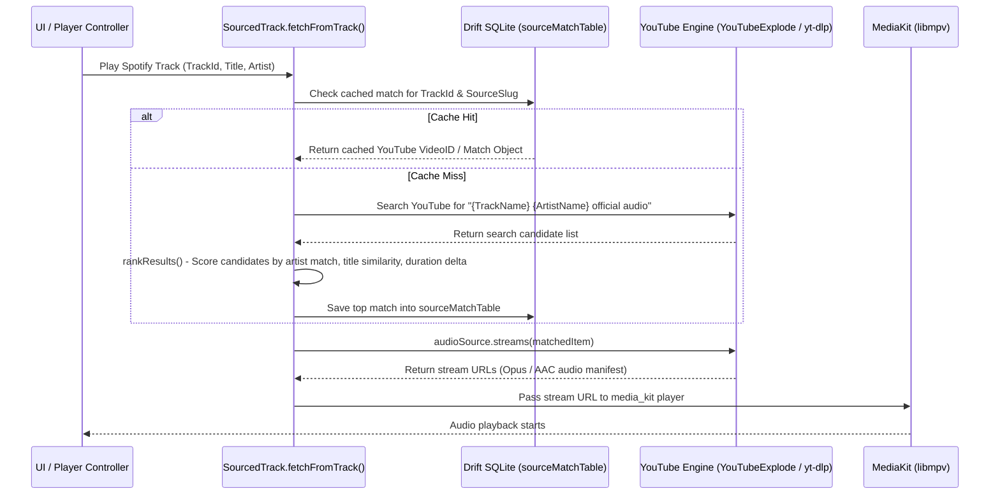

# Spotube — Feature & Implementation Report

**Repository URL**: [https://github.com/krtirtho/spotube](https://github.com/krtirtho/spotube)  
**Version Analyzed**: `5.1.2` (Dart / Flutter)  
**Local Code Location**: `reference/spotube`  
**License**: BSD-3-Clause  

---

## 1. Executive Summary & Core Architectural Concept

Spotube is an open-source, cross-platform desktop and mobile music application built on Flutter. Its fundamental architectural concept is **BYOMM (Bring Your Own Music Metadata)**:
- **Metadata Layer**: Uses Spotify Web API (and public web endpoints) to fetch song titles, artists, albums, playlists, genres, user libraries, and recommendations.
- **Audio Resolution Layer**: Matches Spotify track metadata to audio streams fetched dynamically on-demand from YouTube (via `youtube_explode_dart`, `yt_dlp_dart`, `flutter_new_pipe_extractor`), Piped, or Invidious instances.
- **Result**: Users get a Spotify-like UI/experience with zero Spotify Premium requirement and ad-free playback.

---

## 2. Technical Stack & Dependencies

| Component | Library / Framework | Path / Usage |
| :--- | :--- | :--- |
| **UI Framework** | Flutter 3.29+ / Dart 3.0+ | `lib/` |
| **State Management** | `flutter_riverpod`, `hooks_riverpod` | `lib/provider/` |
| **Audio Engine** | `media_kit` (wrapping `libmpv`) | `lib/services/audio_player/` |
| **OS Media Controls** | `audio_service`, `audio_service_mpris` (Linux), `smtc_windows` (Windows) | `lib/services/audio_services/` |
| **Database & Cache** | `drift` (SQLite ORM) | `lib/models/database/`, `lib/provider/database/` |
| **YouTube Extraction** | `youtube_explode_dart`, `yt_dlp_dart`, `flutter_new_pipe_extractor` | `lib/services/youtube_engine/` |
| **Metadata Tagging** | `metadata_god` | `lib/provider/download_manager_provider.dart` |
| **Remote Sync / Server**| `bonsoir` (mDNS), `shelf` (HTTP/WebSocket) | `lib/provider/connect/`, `lib/provider/server/` |
| **Scrobbling** | `scrobblenaut` (Last.fm) | `lib/provider/scrobbler/` |
| **Lyrics** | `lrc` (Synced LRC), Genius, Musixmatch | `lib/provider/lyrics/` |
| **Plugin / Scripting** | `hetu_script`, `hetu_spotube_plugin` | `lib/provider/metadata_plugin/` |

---

## 3. Audio Engine & Playback Flow

### 3.1 Audio Engine Setup (`lib/services/audio_player/`)
Spotube uses `media_kit` for cross-platform playback. `media_kit` binds directly to `libmpv` native binaries, providing:
- High performance, low overhead decoding (FLAC, MP3, AAC, Opus, OGG).
- Precise seeking and continuous sample tracking.
- Equalizer, volume normalization, and pitch/speed control via mpv commands.

### 3.2 Sourced Track Resolution Flow (`lib/services/sourced_track/sourced_track.dart`)

#### Ranking Algorithm (`rankResults`)
1. **Artist Matching**: Checks if candidate channel title contains track artist name.
2. **Official Video Regex**: Matches `r"official\s(video|audio|music\svideo|lyric\svideo|visualizer)"` against video title.
3. **Duration Comparison**: Penalizes videos whose duration deviates significantly from Spotify metadata duration.

---

## 4. Integrations & Implementation Details

### 4.1 Spotify API Integration (`lib/provider/spotify/`)
- Supports **OAuth2 PKCE** login for Spotify accounts or **Cookie-based login** (`sp_dc`).
- Queries Spotify Web API for:
  - User playlists, saved albums, liked songs (`me/tracks`).
  - Search endpoint (`/v1/search`) for tracks, albums, artists, playlists.
  - Spotify recommendations (`/v1/recommendations`).

### 4.2 Spotube Connect & Remote Sync (`lib/provider/connect/`, `lib/provider/server/`)
- Allows one Spotube instance (e.g., Desktop) to be remote-controlled by another instance (e.g., Mobile phone).
- **Discovery**: Uses `bonsoir` for mDNS local network service advertising (`_spotube._tcp`).
- **Server**: Spawns an in-process HTTP and WebSocket server using Dart's `shelf` package.
- **Protocol**: Exposes WebSocket channels to broadcast play/pause/seek events and sync active queue across local network devices.

### 4.3 SponsorBlock Integration (`lib/provider/skip_segments/`)
- Fetches SponsorBlock API data for the resolved YouTube Video ID.
- Automatically skips non-music segments, music intros, self-promotions, or outro chatter during playback by monitoring player position updates.

### 4.4 Last.fm Scrobbler (`lib/provider/scrobbler/`)
- Utilizes `scrobblenaut` package.
- Listens to audio player position events; triggers `track.scrobble` when track playback passes 50% or 240 seconds.

### 4.5 Lyrics Provider (`lib/provider/lyrics/`)
- Aggregates lyrics from **LRCLIB**, **Genius**, and **Musixmatch**.
- Parses line-by-line synced LRC files using `lrc` package for real-time karaoke scrolling lyrics in the UI.

### 4.6 Plugin & Scripting Engine (`lib/provider/metadata_plugin/`)
- Uses `hetu_script` (an interpreted scripting language for Dart/Flutter).
- Enables community plugins (`hetu_spotube_plugin`) to supply custom metadata sources or stream resolvers without recompiling the main binary.

---

## 5. UI Architecture & Design Details

- **UI Framework**: Responsive layout utilizing `shadcn_flutter` components and custom Material / Fluent UI design tokens.
- **Dynamic Palette**: Uses `palette_generator` to extract dominant colors from current album cover art, dynamically tinting background accents and now-playing bars.
- **Navigation**: Uses `auto_route` with a persistent sidebar (desktop) or bottom navigation rail (mobile), keeping the player bar pinned at the bottom.
- **Virtualized Lists**: Uses `very_good_infinite_list` and `super_sliver_list` for high-performance rendering of multi-thousand track playlists.

---

## 6. Takeaways for Rustic Player

1. **Stream Resolution Caching**: Spotube's pattern of storing resolved YouTube match IDs in SQLite (`sourceMatchTable`) dramatically reduces latency and API calls on subsequent plays.
2. **`media_kit` / `libmpv`**: Demonstrates the viability of `libmpv` for cross-platform audio playback with hardware acceleration.
3. **SponsorBlock**: A high-value quality-of-life feature for YouTube-sourced audio playback.
