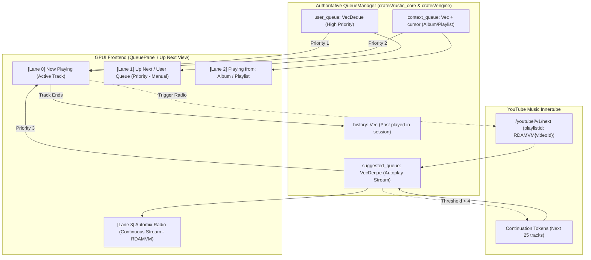

# Phase 1: Multi-Lane Queue System & UI Perfection

> **Sprint Goal**: Solidify the **Multi-Lane Queue Architecture** inside `QueueManager`, eliminate the primitive flat queue in `crates/engine`, integrate YouTube Music's `RDAMVM` auto-radio recommendation engine, and build a butter-smooth, virtualized 3-lane Queue/Up Next UI.
> **Detailed Specification**: [`plans/3-lane-queue-and-ytm-plan.md`](file:///f:/VSCodium/Github/RusticPlayer/plans/3-lane-queue-and-ytm-plan.md)

---

## 1. Why Multi-Queue / Multi-Lane Must Be Preserved (Never Merged into a Flat List)

Merging all queues into a single flat `Vec<Track>` is a classic music player anti-pattern that breaks core user experience:

1. **Album Context vs. "Play Next"**:
   - If a user is listening to an album (Tracks 1–12) and queues a single song via "Play Next":
     - In a **multi-lane model**, that song belongs to the **User Queue (Priority Lane)**. It plays next, and the album resumes where it left off.
     - Tapping **"Clear Queue"** clears *only* the user-queued tracks, leaving the album context intact.
     - In a **flat merged list**, clearing the queue wipes out the album they were listening to!
2. **Autoplay Pollution**:
   - When a song or album ends, YouTube Music generates continuous radio recommendations (`RDAMVM`).
   - In a **multi-lane model**, these reside in the separate **Radio/Automix Lane**. They never pollute the user's manual queue or the album tracklist.
   - If the user turns Autoplay OFF, the radio lane disappears cleanly without affecting any user-added songs.
3. **Shuffle & Un-Shuffle Invariants**:
   - Shuffling must only reorder the **Context Queue** (album/playlist).
   - **User Queue tracks must NEVER be shuffled** (if the user explicitly enqueued Song A to play next, it must play next regardless of shuffle mode).
   - Turning Shuffle OFF restores the album's original track order while keeping user-queued songs pinned in their exact positions.

---

## 2. How Other Native Players Implement Multi-Queue

| Client | Architecture Pattern | Implementation Details |
|---|---|---|
| **Spotify / Apple Music** | **3-Tier Priority Queue** | 1. **User Queue** (Highest priority, FIFO manual additions, un-shuffled). 2. **Context Queue** (Active playlist/album tracks with persistent cursor). 3. **Autoplay/Radio** (Dynamic recommendations that play only when lanes 1 & 2 are exhausted). |
| **ViMusic / InnerTune (`vivi-music`)** | **Split `currentQueue` + `automixItems`** | • `currentQueue` holds the active playlist/album and manual additions. • `automixItems` is maintained in a **completely separate reactive list** (`PERSISTENT_AUTOMIX_FILE`). • The UI renders them as separate visual cards. Dragging an automix item promotes it into the user queue. |
| **RusticPlayer Target** | **`QueueManager` Multi-Lane Engine** | Solidify the `QueueLane` model in [`crates/rustic_core/src/queue/mod.rs`](file:///f:/VSCodium/Github/RusticPlayer/crates/rustic_core/src/queue/mod.rs) and promote it as the single state machine driving [`crates/engine`](file:///f:/VSCodium/Github/RusticPlayer/crates/engine/src/lib.rs). |

---

## 3. The 3-Lane Target Architecture

---

## 4. Playback Advance Priority Rule

When the current track ends or the user clicks "Next", `QueueManager::advance()` resolves the next track using this strict deterministic priority:

1. **Lane 1 — User Queue**: If `!user_queue.is_empty()`, pop front of `user_queue` and play.
2. **Lane 2 — Context Queue**: Else if `context_cursor + 1 < context_queue.len()`, advance `context_cursor += 1` and play next song in the active album/playlist.
3. **Lane 3 — Radio / Automix Queue**: Else if `autoplay_enabled` and `!suggested_queue.is_empty()`, pop front of `suggested_queue` and play.
4. **Lane 4 — Stop**: If all three lanes are empty, stop playback and emit `Event::PlaybackStateChanged(Stopped)`.

---

## 5. Detailed Phase 1 TODO Checklist

### Step 1.1: Multi-Lane Engine Refactor (`crates/rustic_core` & `crates/engine`)
- [x] **T1.1.1 — Formalize Multi-Lane Structure in `QueueManager`**:
  - Refactored `QueueManager` to explicitly maintain:
    - `user_queue: VecDeque<Track>` (tracks added via "Play Next" or "Add to Queue").
    - `context_queue: Vec<Track>` & `context_cursor: usize` (tracks from the active album/playlist).
    - `suggested_queue: VecDeque<Track>` (tracks from `RDAMVM` auto-radio).
    - `history: Vec<Track>` (session history, capped at 50 tracks).
- [x] **T1.1.2 — Connect `QueueManager` to `crates/engine::EngineLoop`**:
  - Replaced the primitive `self.state.queue: Vec<Track>` in `crates/engine/src/lib.rs` with `QueueManager`.
  - Wired `EngineLoop::handle_command` to call `QueueManager` methods:
    - `PlayTrack`: Clears user queue, sets context or radio, plays track.
    - `EnqueueNext(Track)`: Pushes front to `user_queue`.
    - `EnqueueEnd(Track)`: Pushes back to `user_queue`.
    - `RemoveUserQueueItem(index)`: Removes from `user_queue` without touching context.
    - `ClearUserQueue`: Empties `user_queue` while keeping album/playlist playing.
    - `MoveUserQueueItem { from, to }`: Reorders user queue.
    - `ToggleAutoplay(bool)`: Enables/disables consumption from `suggested_queue`.
- [x] **T1.1.3 — Broadcast Multi-Lane Snapshots to UI**:
  - On any queue modification, emit `Event::QueueUpdated(Box<MultiLaneQueueSnapshot>)` so the UI knows exactly what is in the User Queue vs Context vs Radio.

---

### Step 1.2: YouTube Music Automix Radio & Prefetch Pipeline (`crates/sources`)
- [x] **T1.2.1 — Automix Radio Generator (`RDAMVM`)**:
  - When playing any track, call `/youtubei/v1/next` with `playlistId = "RDAMVM" + video_id`.
  - Populate `suggested_queue` with the returned 25 radio tracks.
- [x] **T1.2.2 — Background Continuation Token Prefetcher**:
  - When `suggested_queue.len() < 4` and Autoplay is enabled, asynchronously fetch the next batch using Innertube's `continuation` token.
- [x] **T1.2.3 — Audio Stream URL Resolve-Ahead (Depth = 1)**:
  - While track $N$ is playing, pre-resolve the audio CDN URL of the upcoming track (from User Queue, Context, or Radio) and prefetch the initial block into cache.

---

### Step 1.3: 3-Lane UI Perfection in GPUI (`crates/app` & `crates/ui-kit`)
- [x] **T1.3.1 — Render Visual Lanes in `QueuePanel` / Up Next View**:
  - **Now Playing Card**: Album art, title, artist, live waveform visualizer.
  - **User Queue Section**: Shows only if `!user_queue.is_empty()`. Displays "USER QUEUE • N" with a "Clear" button and delete buttons.
  - **Context Section**: Shows remaining tracks in the active Album or Playlist: "NEXT IN [ALBUM/PLAYLIST] • N".
  - **Automix Radio Section**: Shows dynamic radio recommendations with "AUTOPLAY & SIMILAR • N" and autoplay toggle switch.
- [x] **T1.3.2 — Promotion from Radio to User Queue**:
  - Allow users to click "＋ Queue" on any Automix recommendation to immediately promote it into their **User Queue**.
- [x] **T1.3.3 — Virtualized 60fps Scrolling & Sidebar Queue Alignment**:
  - Aligned `QueuePanel` in `main.rs` to render 3-lane categorized items (`QueueLane::User`, `QueueLane::Context`, `QueueLane::Radio`) and dispatch reordering, deletion, and track selection cleanly to `Engine`.

---

## 6. Verification & Acceptance Criteria

1. **Lane Isolation**: Adding a song to queue via "Play Next" does not alter or re-index the album tracklist.
2. **Clear Queue Safety**: Tapping "Clear Queue" clears *only* the user queue; the current song and album continue playing.
3. **Continuous Autoplay**: When the user queue and album finish, playback transitions into the automix radio stream with zero silence.
4. **Instant Prefetch**: Track changes have zero loading spinner or network delay due to Depth=1 resolve-ahead.
